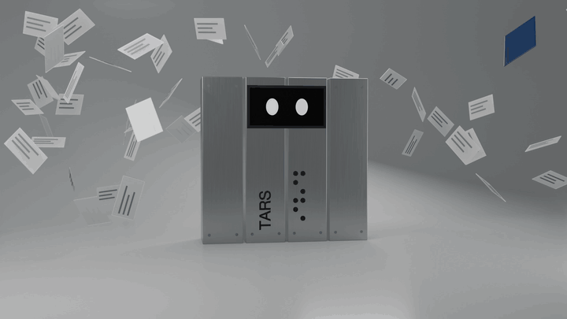
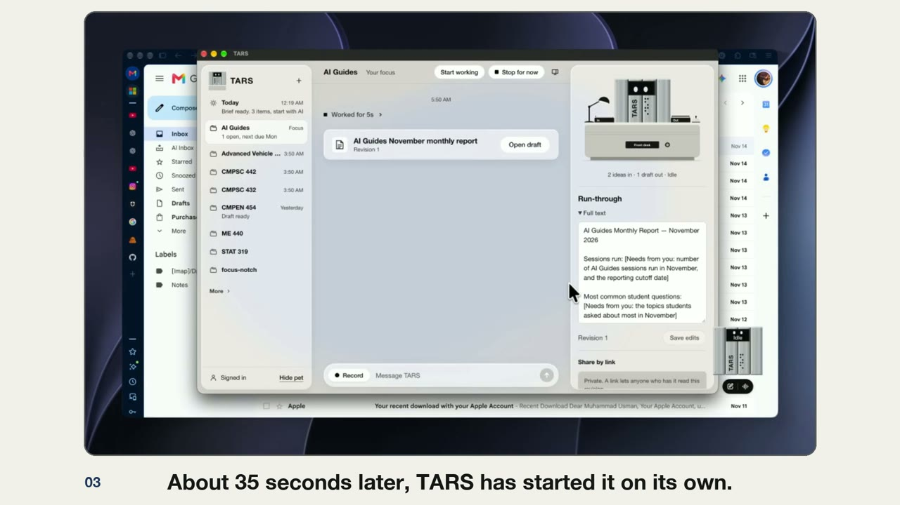
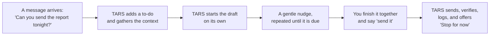
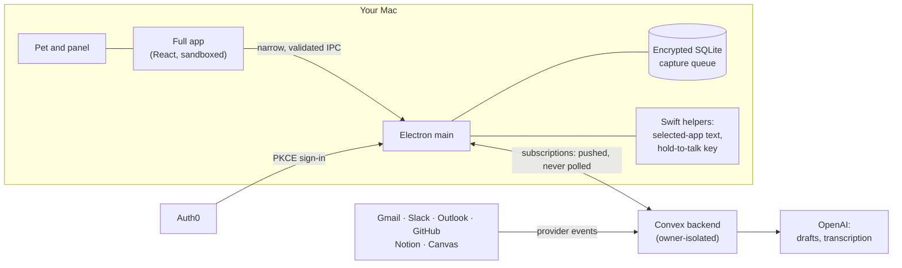

  

<h1 align="center">TARS</h1>

  <b>A Mac desktop companion for entrepreneurs with ADHD.</b> 
  It carries the remembering, starts the work, and nudges gently. No streaks, scores or guilt.

Built at HackUMass XIV · hacking period 13–15 November 2026

   
  <b><a href="docs/media/tars-product-video.mp4">Watch the product video (1 min 16 s)</a></b> 
  The app footage is one take from the packaged app on a real Gmail account, recorded 15 November 2026.

---

## The problem

Have you ever opened your laptop to do one thing, and twenty minutes later you were doing something else, and the
first thing still wasn't done?

For a founder with ADHD that is a normal day. The work is spread over five apps, a new and louder thing keeps
arriving, and a reminder does not help, because a reminder still leaves you alone with a blank page.

| Measured | Source |
| --- | --- |
| 29% of entrepreneurs in one study reported ADHD, against 5% of the comparison group | [Freeman et al., Small Business Economics, 2019](https://ideas.repec.org/a/kap/sbusec/v53y2019i2d10.1007_s11187-018-0059-8.html) (self-reported, 242 entrepreneurs) |
| 15.5 million U.S. adults had a current ADHD diagnosis in 2023 | [CDC, published October 2024](https://www.drugs.com/news/15-5-million-adults-had-current-adhd-diagnosis-2023-121850.html) |
| About 22 days of work performance lost a year per worker with ADHD | [WHO World Mental Health Survey, 2008](https://www.fic.nih.gov/News/GlobalHealthMatters/Pages/ADHDLowersGlobalProductivity.aspx) |
| More than 20 minutes to get back to a task after an interruption | [Gloria Mark, UC Irvine](https://ics.uci.edu/2016/07/25/quartz-neuroscientists-say-multitasking-literally-drains-the-energy-reserves-of-your-brain-mark-quoted/) (office workers in general) |

## What TARS does

Around that loop: a morning brief with one place to start, TARS's own calendar of what it did and plans to do,
hold-a-key dictation into an editable box, and "What I remember", where you can correct TARS or tell it to forget.

## Status: what is proven and what is not

This table is kept honest on purpose. "Live" means seen working on a real account in the packaged app.

| | State (as of 14 November, 23:10 EST) |
| --- | --- |
| Sign-in | **Live.** A real Auth0 sign-in from the packaged app; the backend accepted that identity |
| Gmail through Composio | **Live.** A personal Gmail account connected from the packaged app |
| Preparation | One real model run on illustrative data |
| Notes folder, Claude Code and Codex excerpts | Proven on one Mac |
| Automatic draft and gentle nudges on a new message | Built and tested against fixtures; **not yet seen live** |
| Slack, Outlook mail and GitHub through Composio; share by read-only link; text nudges to your own phone | Built and tested against fixtures; **not yet seen live** |
| Notion, Canvas and the direct connectors | Built and tested against fixtures; **not yet connected to a real account** |
| Dictation, notifications, app observation, real sends, outcome log | Built; **never run live** |

Tests: 288 unit, 216 integration, and an end-to-end suite that drives the packaged app.

## How it is built

Electron + React + TypeScript desktop app; Convex for owner-isolated cloud state and push subscriptions; Auth0 for
native sign-in; OpenAI for preparation and transcription. Captures are saved first to an encrypted local SQLite
queue, so they survive restarts and offline use. The renderer is sandboxed and talks to the main process only
through a narrow, schema-validated IPC API. Nothing is polled on a timer: updates arrive through provider events,
Convex subscriptions and native file events.

## The app

Three windows from one renderer:

- **The full app.** Today (one recommended start, with TARS at its front desk), Projects, a project with its
  prepared work and editable run-through, Schedule (your meetings and real due dates), TARS's calendar (what it
  did and will do on its own), Connections, What I remember.
- **The pet.** TARS on your desktop with no window around it. Drag it anywhere; it never takes focus on its own.
- **The panel.** Opens when you rest the pointer on the pet (or click it): where you left off, what today holds,
  Open app, Stop for now, quick capture.

Every source starts off; capture works before any source is connected. TARS acts outside the app only on your
explicit instruction, verifies the result, and logs it separately. `tests/e2e/harness/` is a test-only page that
mounts the same screens with illustrative data for visual review; it is never bundled into the app.

## Scripts (run from the repo root, with pnpm)

| Script | What it does |
| --- | --- |
| `pnpm test:unit` | Vitest unit tests in `tests/unit` |
| `pnpm test:integration` | Vitest integration tests in `tests/integration` (Convex) |
| `pnpm test:e2e` | Playwright drives the packaged app (`pnpm package:mac` first) and the test-only screen harness |
| `pnpm typecheck` | TypeScript for tests, domain, Convex and every workspace package |
| `pnpm lint` | ESLint |
| `pnpm build` | electron-vite build of the desktop app into `apps/desktop/out` |
| `pnpm package:mac` | Unsigned arm64 `.app` in `apps/desktop/release/mac-arm64` |
| `pnpm --filter @companion/desktop dev` | Run the desktop app against the Vite dev server |
| `pnpm verify` | typecheck + lint + unit + integration |

## Environment

Names are listed in `.env.example`; values live in `.env.local` (git-ignored) or the Convex dashboard.
`AUTH0_DOMAIN` and `AUTH0_CLIENT_ID` (public identifiers) are built into the desktop app at build time, because
an app opened from Finder has no shell environment; set both on the Convex deployment too. Without them the app
shows "Not signed in". The Auth0 Native application must allow the callback `http://127.0.0.1:51735/callback`.
The Convex deployment also needs `TOKEN_ENCRYPTION_KEY`, `OPENAI_API_KEY`, `OPENAI_MODEL` and, for dictation,
`OPENAI_TRANSCRIBE_MODEL`; each connector needs its own provider settings.

## Third-party code and libraries

All external code is used as published npm packages; no third-party source was copied into this repo.

| Package | Used for | License |
| --- | --- | --- |
| electron | Desktop runtime, safeStorage (Keychain-protected keys) | MIT |
| electron-vite | Build tooling for main/preload/renderer | MIT |
| electron-builder | Packaging the macOS app | MIT |
| vite | Bundler used by electron-vite | MIT |
| react, react-dom | Renderer UI | MIT |
| better-sqlite3 | Local durable capture queue | MIT |
| zod | Runtime schema validation at IPC/storage boundaries | MIT |
| convex, convex-test | Cloud backend and its test harness | Apache-2.0 |
| @edge-runtime/vm | Edge runtime for Convex tests | MIT |
| vitest | Unit and integration tests | MIT |
| @playwright/test | Packaged-app end-to-end test | Apache-2.0 |
| typescript, @types/node, @types/react, @types/react-dom, @types/better-sqlite3 | Type checking | Apache-2.0 / MIT |
| eslint, typescript-eslint | Linting | MIT |

Brand marks in `apps/desktop/src/renderer/logos.tsx` identify the services and are trademarks of their owners:
Gmail, Notion, Canvas and Claude from Simple Icons (CC0); Slack's mark from slack.com; Outlook's icon from
Microsoft's Fluent brand-icons CDN. The name TARS and the idea of a slab-shaped robot come from a film; the
drawings here are original.

External services: Composio hosts the Gmail, Slack, Outlook and GitHub connections and holds their OAuth tokens;
Convex, Auth0 and OpenAI are used through their public APIs. The rakazo project (Apache-2.0) was studied for ideas;
no code was copied.

Standards followed (not code): RFC 8252 (OAuth for native apps), RFC 7636 (PKCE; its Appendix B test vector is used in `tests/unit/auth.test.ts`), OpenID Connect Core.
